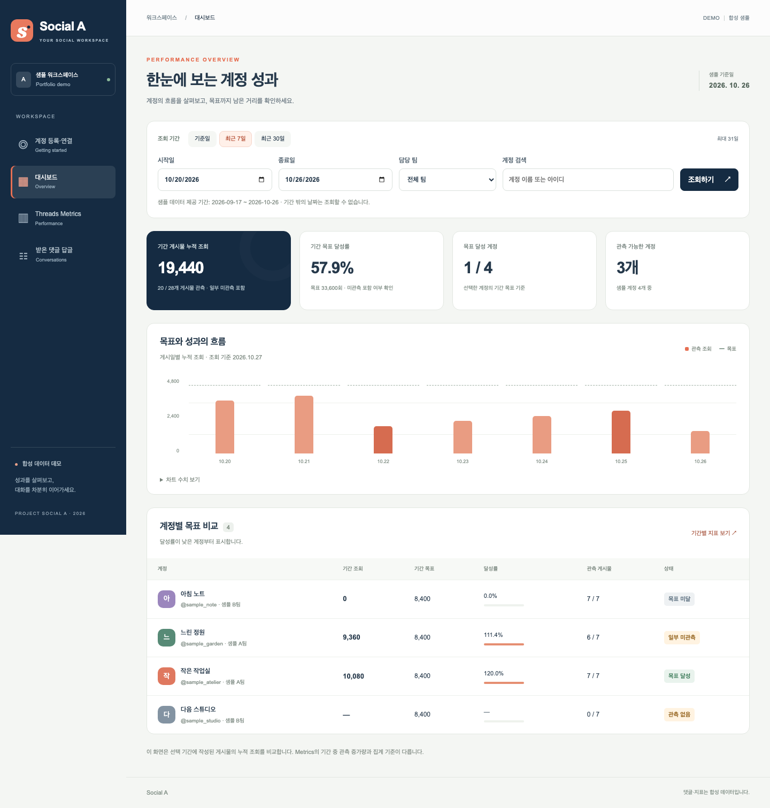

# Social A

여러 Threads 계정의 성과를 비교하고, 받은 댓글에 달 답글을 검토하는 웹앱입니다. 팀원들이 계정마다 성과를 확인하는 데 시간이 걸려 만들기 시작했습니다. 팀원은 원본 운영 도구의 대시보드와 Metrics에서 조회한 결과를 일간 보고 작성에 활용했습니다.

[포트폴리오 PDF](assets/social-a-portfolio-ko.pdf) · [로컬 실행 방법](#로컬-실행)



## 로컬 실행

Node.js 22.13 이상과 npm이 필요합니다. 데모는 예시 계정과 게시물을 사용하므로 로그인이나 API 키 설정 없이 실행할 수 있습니다. 프로젝트 폴더에서 다음 명령을 실행하세요.

```sh
npm ci
npm run build
npm start
```

서버가 시작되면 [로컬 대시보드](http://127.0.0.1:43170/dashboard)를 여세요. 담당 팀에서 `샘플 A팀`을 고르고 **조회하기**를 누르면 두 계정의 성과를 나란히 볼 수 있습니다.

## 화면에서 할 수 있는 일

| 화면 | 사용 흐름 |
| --- | --- |
| 대시보드 | 기간과 계정을 골라 그 기간에 게시한 글의 누적 조회수와 목표 달성률을 비교합니다. |
| Threads Metrics | 기간 중 조회수가 얼마나 늘었는지, 팔로워 수가 어떻게 변했는지 살펴봅니다. |
| 받은 댓글 | 원글과 댓글을 함께 읽고, 준비된 답글 후보를 골라 수정합니다. 저장한 뒤 같은 브라우저에서 새로고침하면 고친 문장을 다시 볼 수 있습니다. |

데모의 지표는 2026년 9월 17일부터 10월 26일까지의 예시 자료입니다. 답글은 임시 저장되며, 실제 Threads 계정에 연결하거나 답글을 생성·게시하지 않습니다. [화면별 시연 가이드](DEMO-WALKTHROUGH.md)

## 팀과 함께 만든 과정

시안을 공유한 뒤 팀원은 하루 단위로도 성과를 보고 싶다고 했습니다. 저는 팀의 요청을 정리하고, 공유된 주차별 조회수 목표를 계정별 성과 기준으로 써도 되는지 먼저 확인하자고 했습니다. 입력값에 따른 결과 검증을 Codex에 맡겼고, 코드 작성과 테스트 실행, 결함 수정에도 Codex를 활용했습니다.

## 구현과 검증

Next.js, React, TypeScript로 만들었습니다. 대시보드는 게시일을 기준으로 글을 모으고, Metrics는 선택한 기간의 조회 기록을 비교해 증가량을 계산합니다. 예를 들어 기존 글의 조회수가 100에서 160이 되면 Metrics에 반영되는 증가량은 60입니다. 테스트에서는 조회수가 그대로인 경우와 비교할 기록이 부족한 경우도 구분해 확인했습니다.

## 라이선스

데모 소스와 설명 문서에는 [MIT 라이선스](LICENSE)가 적용됩니다. 포트폴리오 PDF와 화면 이미지의 권리 범위는 [권리 안내](RIGHTS.md), 외부 라이브러리는 [의존성 고지](THIRD-PARTY-NOTICES.md)에서 확인할 수 있습니다.
